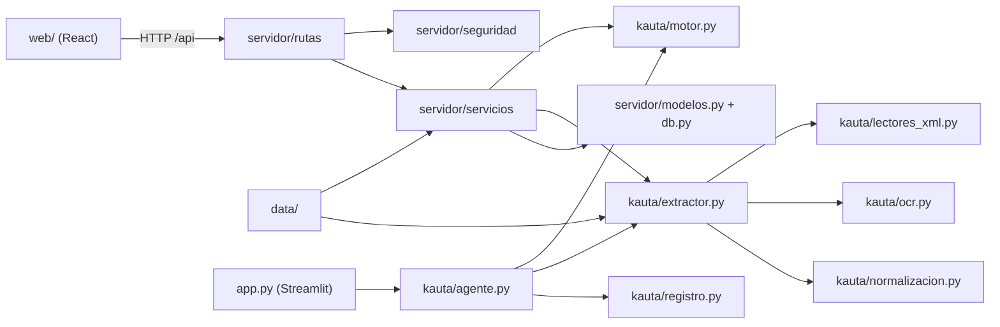

# Componentes de Kauta

Sirve para listar los componentes reales (módulos) y cómo dependen entre sí. Fuente: `aidlc-docs/inception/hechos-del-codigo.md` §3 y §2 (rutas relativas a `kauta/`). Fecha: 2026-10-17. Solo lo construido; sin componentes propuestos.

## Vista de dependencias

`kauta/agente.py`, `registro.py` y `ui.py` solo los usan `app.py` y `tests/test_kauta.py`; el servidor importa solo `motor` y `extractor` (hechos §3; `servicios/agente.py:27-28`).

## Núcleo `kauta/` (sin FastAPI)

| Componente | Responsabilidad | Públicos principales | Líneas |
|---|---|---|---|
| `motor.py` | Evalúa las 13 reglas, pura y determinista, sin IA | `evaluar`, `CATALOGO`, `Decision`, `buscar_beneficiario` | 478 |
| `extractor.py` | Lee PDF, imagen, `.eml`, `.txt`, XML, ZIP; hashes; detecta instrucciones | `leer_documento`, `ExtractorReferencia`, `ExtractorIA`, `enriquecer` | 397 |
| `lectores_xml.py` | XML fiscal exacto (CFDI 4.0, UBL DIAN), ZIP seguro, QR/CUFE/CAE | `leer_xml_fiscal`, `abrir_zip`, `contrastar` | 562 |
| `normalizacion.py` | Validadores fiscales y bancarios, moneda, monto, fecha, modelo canónico | `validar_id_fiscal`, `FacturaCanonica` | 580 |
| `ocr.py` | Texto incrustado del PDF u OCR Tesseract y campos por patrones | `leer`, `campos_desde_texto` | 526 |
| `agente.py` | Agente en memoria (Streamlit y pruebas) | `Agente` | 201 |
| `registro.py` | Registro JSONL con cadena SHA-256 | `Registro` | 69 |
| `ui.py` | HTML y CSS de Streamlit | `badge`, `kpi`, `tarjeta_factura` | 208 |

## Servidor `servidor/`

| Componente | Responsabilidad | Públicos principales | Líneas |
|---|---|---|---|
| `main.py` | App FastAPI, routers, middlewares, sirve `web/dist` | `app`, `/api/salud` | 82 |
| `config.py` | Configuración por variables de entorno y claves | `CONFIG`, `cargar` | 87 |
| `db.py`, `modelos.py` | SQLAlchemy 2.0 y 16 tablas | `motor_bd`, `Base` | 37, 372 |
| `esquemas.py`, `vistas.py` | Entradas Pydantic (`extra="forbid"`) y JSON de salida | `ReglasIn`, `factura_detalle` | 149, 116 |
| `rutas/` | Endpoints: auth, control, dinero, negocio, personas, simulador | un `APIRouter` por archivo | 891 |
| `seguridad/` | Permisos, sesiones, CSRF, cabeceras, cifrado, firma, contraseñas, TOTP, límites | `requiere`, `cifrar`, `firmar` | 406 |
| `servicios/agente.py` | Orquesta extracción, motor, pago, aprobaciones, reevaluación | `procesar_archivo`, `aprobar`, `reevaluar` | 377 |
| `servicios/pagos.py` | Rieles, cotización, firmas, línea de tiempo | `cotizar`, `crear_y_ejecutar` | 235 |
| `servicios/wallet.py` | Libro mayor de doble partida | `transferir`, `verificar_libro` | 111 |
| `servicios/auditoria.py` | Cadena HMAC en la tabla `auditoria` | `registrar`, `verificar` | 75 |
| `servicios/costos.py`, `metricas.py` | Libro de costos y métricas desde una sola fuente | `registrar_lectura`, `recibo`, `rendimiento` | 133, 368 |
| `servicios/simulador.py` | Escenarios, factura sintética, simulación de años | `crear_factura`, `simular_anio` | 435 |
| `servicios/semilla.py` | Datos de la demo, restablecer, preparar recorrido | `iniciar`, `restablecer`, `preparar_recorrido` | 195 |
| `servicios/usuarios.py` | Invitaciones, registro, roles, activación | `invitar`, `cambiar_rol` | 264 |
| `servicios/__init__.py` | Candado global del proceso | `BLOQUEO` (RLock) | 6 |

## Pantalla `web/src`

| Componente | Responsabilidad | Líneas |
|---|---|---|
| `App.tsx` | Marco, navegación (Operar, Dinero, Control), selector de persona | 139 |
| `api.ts` | Cliente HTTP, hooks `useApi`, `useRuta`, permisos `puede()`, formato de dinero | 273 |
| `ui.tsx` | Componentes compartidos (Panel, Boton, Modal, TiraReglas, LineaTiempo...) | 364 |
| `pages/` (12 archivos) | Resumen, Facturas, Detalle, ReciboFactura, Pregunta, Simulador, Wallet, Rendimiento, Proveedores, Reglas, Auditoría, Seguridad | 1433 |

Sin pantalla de login ni de personas desde el commit `7a9e108` (hechos §9). Sin `innerHTML` (hechos §9).

## Datos, operación y pruebas

| Componente | Contenido | Evidencia |
|---|---|---|
| `data/` | `empresa.json`, `reglas.json`, `tarifas.json`, `beneficiarios.json` (15), `esperado.csv`, `referencia_extracciones.json`, `facturas/` (20), `sorpresa/` (4) | hechos §15 |
| `ops/` | `kauta.service` (systemd, puerto 8840), `nginx.kauta` | hechos §14 |
| `Dockerfile`, `docker-compose.yml` | Imagen en 2 etapas; compose con Postgres opcional | hechos §1 |
| `tests/` | 60 funciones, 76 casos | hechos §13 |
| `scripts/` | Generador del set, mediciones, recorrido Playwright | hechos §13 |
| `app.py` | Pantalla Streamlit de respaldo (plan B), aplicación aparte sin base ni roles | hechos §17 #20 |
