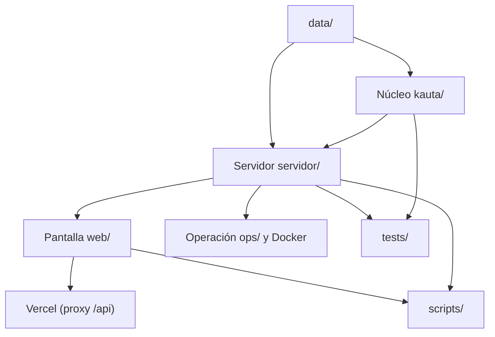

# Unidades de trabajo de Kauta

Sirve para fijar las unidades reales del repositorio y su orden de dependencia. Fuente: `hechos-del-codigo.md` §2, §3 y §13, y `kauta/README.md:120-127`. Fecha: 2026-10-17. Describe la estructura construida; el reparto de personas del equipo es NO DOCUMENTADO para Kauta.

## Unidades

| Unidad | Carpeta | Contiene | Depende de | Entrega |
|---|---|---|---|---|
| Núcleo | `kauta/kauta/` | Motor de 13 reglas, extractores, normalización, OCR | `data/` (reglas, empresa, referencia) | Decisión determinista y extracción normalizada |
| Servidor | `kauta/servidor/` | API, seguridad, pagos, wallet, auditoría, costos, simulador, semilla | Núcleo, `data/`, base de datos | API bajo `/api` con roles y firmas |
| Pantalla | `kauta/web/` | React 19, TypeScript, Vite, Tailwind 4; 11 rutas | API del servidor | Aplicación compilada en `web/dist`, servida por el servidor o por Vercel |
| Datos | `kauta/data/` | Empresa, reglas v1, tarifas, 15 beneficiarios, 20 facturas, 4 sorpresa, esperados | Generador `scripts/generar_set.py` | Set reproducible con resultados esperados |
| Scripts | `kauta/scripts/` | Generar el set, medir extracción y OCR, contrastar validadores, recorrido Playwright, empaquetar | Núcleo, servidor, pantalla | Mediciones y recorrido reproducible |
| Pruebas | `kauta/tests/` | 60 funciones, 76 casos | Núcleo y servidor | Contrato de regresión |
| Operación | `kauta/ops/`, `Dockerfile`, `docker-compose.yml`, `web/vercel.json` | Servicio systemd, nginx, imagen, proxy de Vercel | Servidor y pantalla | API con HTTPS en `kauta.2-25-233-186.sslip.io` |
| Respaldo | `kauta/app.py` | Pantalla Streamlit con agente en memoria | `kauta/agente.py`, `registro.py`, `ui.py` | Plan B independiente |

## Orden de dependencia

## Reglas de frontera observadas

| Regla | Evidencia |
|---|---|
| El servidor consume el núcleo solo por `motor` y `extractor` | `servicios/agente.py:27-28` |
| `agente.py`, `registro.py` y `ui.py` no los usa el servidor | hechos §3 |
| La pantalla no calcula decisiones: lee la API; los permisos de la pantalla solo ocultan botones | `api.ts:264`, hechos §8 |
| Un solo proceso del servidor | `servicios/__init__.py:4-6` |
| Los datos y las claves de runtime viven fuera del repositorio | `kauta/README.md:97` |

## Contrato de regresión
Las pruebas del servidor (`tests/test_servidor.py`, 28 funciones) cubren set 20 de 20, permisos por rol, doble firma, pago único, auditoría, libro cuadrado, simulador, cargas rechazadas, persona sin contraseña y recorrido F12. La API de contraseñas e invitaciones se conserva por la decisión D8 (`kauta-estado-2026-10-17.md:78-81`). Las pruebas no se ejecutaron para este documento.
