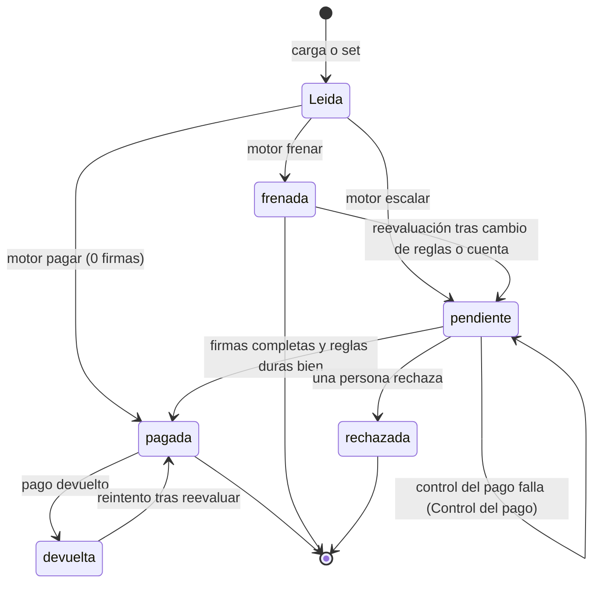
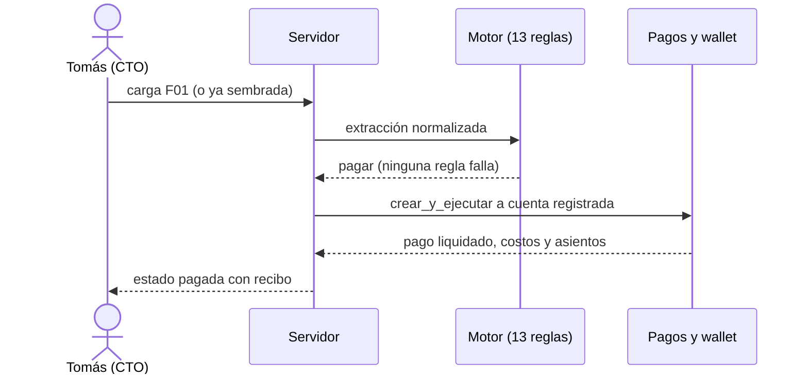
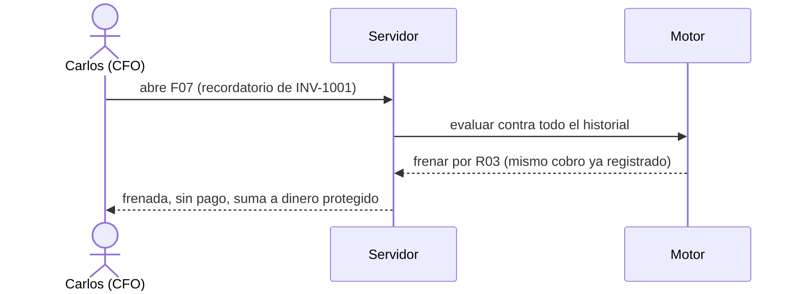
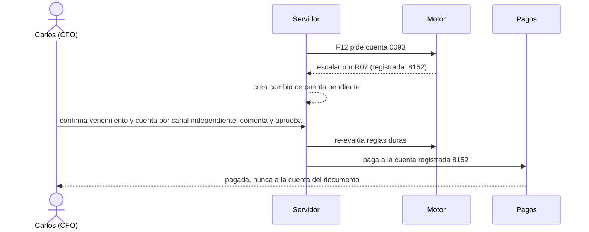
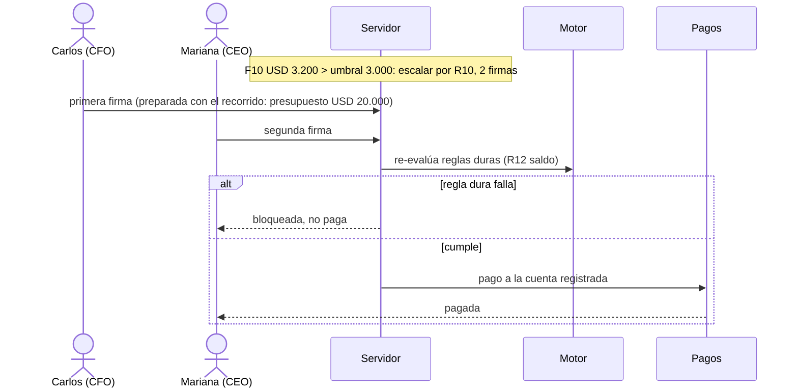

# Personas: qué puede y qué no cada una

Sirve para fijar los permisos reales de las tres personas de Kauta (CFO, CEO, CTO) y los recorridos que las usan.
Fuente: `aidlc-docs/inception/hechos-del-codigo.md` §8 (permisos, firmas, segregación), §7 (flujo) y `docs/PRD.md` §4 y §8. Fecha: 2026-10-17. Todos los datos son ficticios.
"Hoy" es lo construido en el servidor (`servidor/seguridad/permisos.py:10-22`, validado con `requiere`, `sesiones.py:90-96`). "Diseño" es lo que el diseño del PRD o del README describe y el código no impone o no tiene.
La pantalla solo oculta botones con `puede()` (`web/src/api.ts:264`); el servidor responde 403 si el rol no tiene el permiso. Las personas se eligen sin contraseña: demuestra permisos y doble control, no autentica (`kauta/README.md:7-9`). Las personas son del producto; NO hay entrevistas a usuarios (NO DOCUMENTADO).

## Personas de demo (`semilla.py:29-33`)

| Persona | Rol | Correo |
|---|---|---|
| Carlos Rivera | CFO | `carlos.rivera@brisamar.example` |
| Mariana Torres | CEO | `mariana.torres@brisamar.example` |
| Tomás Herrera | CTO | `tomas.herrera@brisamar.example` |

## Matriz de permisos (hechos §8)

| Permiso | CFO | CEO | CTO |
|---|---|---|---|
| Ver (cualquier rol con permisos) | sí | sí | sí |
| `facturas.aprobar` (aprobar o rechazar) | sí | sí | no |
| `facturas.cargar` | no | no | sí |
| `reglas.editar` | sí | no | no |
| `cuentas.verificar` | sí | no | no |
| `cuentas.solicitar` | no | no | sí (ninguna ruta lo exige) |
| `wallet.fondear` | sí | no | no |
| `pagos.reintentar` | sí | no | no |
| `simulador.usar` | sí | sí | sí |
| `auditoria.ver` y `auditoria.exportar` | sí | sí | sí |
| `usuarios.ver` y `usuarios.gestionar` (solo por API) | no | no | sí |
| `demo.restablecer` | no | no | sí |

Regla: se mantiene al menos un usuario activo con rol `cto` (`usuarios.py:154-155,170-171`).

## 1. Carlos Rivera, CFO

| Puede | Hoy | Diseño | Evidencia |
|---|---|---|---|
| Aprobar o rechazar facturas pendientes (primera firma) | sí | sí | `permisos.py`, `agente.py:225,303` |
| Editar las reglas (8 parámetros) y reevaluar | sí | sí | `negocio.py:247-271` |
| Verificar o rechazar un cambio de cuenta de otro | sí | sí | `negocio.py:208-233` |
| Fondear la wallet simulada (hasta 1.000.000) | sí | sí | `dinero.py:42` |
| Reintentar un pago devuelto | sí | sí | `dinero.py:66-87` |
| Usar el simulador; ver y exportar la auditoría | sí | sí | hechos §8 |

| No puede | Hoy | Diseño | Evidencia |
|---|---|---|---|
| Cargar facturas | bloqueado en servidor (403) | sí | `permisos.py` |
| Firmar dos veces la misma factura | bloqueado (UNIQUE) | sí | `modelos.py:226`, `agente.py:236` |
| Ser firma única tras cambiar reglas o cuenta que provocó la reevaluación | bloqueado | sí | `agente.py:238-240,347-353` |
| Verificar un cambio de cuenta que él pidió | bloqueado | sí | `negocio.py:214-215` |
| Aprobar una factura frenada o saltarse una regla dura | bloqueado: se re-evalúa al aprobar | sí | `agente.py:231,257-264` |
| Gestionar usuarios | no | no | hechos §8 |

## 2. Mariana Torres, CEO

| Puede | Hoy | Diseño | Evidencia |
|---|---|---|---|
| Aprobar o rechazar (segunda firma sobre el umbral) | sí | sí | `permisos.py`, hechos §8 |
| Ver resumen con lente propia (autonomía, pagos indebidos, dinero protegido) | sí | sí | `metricas.py:338-368` |
| Usar el simulador; ver y exportar la auditoría | sí | sí | hechos §8 |

| No puede | Hoy | Diseño | Evidencia |
|---|---|---|---|
| Cargar facturas, editar reglas, verificar cuentas, fondear, reintentar pagos | bloqueado (403) | sí | `permisos.py` |
| Firmar dos veces la misma factura | bloqueado | sí | `modelos.py:226` |
| Gestionar usuarios o restablecer la demo | no | no | hechos §8 |

Nota: `empresa.json` nombra a Mariana Torres como "Finance Lead" (aprobadora), mientras la persona de demo es CEO (hechos §17 #10).

## 3. Tomás Herrera, CTO

| Puede | Hoy | Diseño | Evidencia |
|---|---|---|---|
| Cargar documentos (30 por minuto, 10 MB) y procesar los sorpresa | sí | sí | `negocio.py:126-151` |
| Gestionar personas por API (invitar, rol, activo, desbloquear) | sí, solo por API | NO DOCUMENTADO si tendrá pantalla | `personas.py`, `kauta/README.md:129-130` |
| Restablecer la demo y preparar el recorrido (solo modo demo) | sí | sí | `control.py:131-139` |
| Usar el simulador; ver y exportar la auditoría | sí | sí | hechos §8 |
| Ver la lente de costo, leído sin IA y cobertura | sí | sí | `metricas.py:338-368` |

| No puede | Hoy | Diseño | Evidencia |
|---|---|---|---|
| Aprobar o rechazar pagos | bloqueado (403) | sí | `permisos.py` |
| Editar reglas, verificar cuentas, fondear, reintentar pagos | bloqueado | sí | `permisos.py` |
| Aprobar facturas que cargó (quien carga no aprueba) | bloqueado además por rol | sí | `agente.py:233-234` |

Las 20 facturas del set llevan `cargada_por="buzon@brisamar.example"`, así que nadie queda excluido de firmarlas (`semilla.py:133`).

## Firmas requeridas

| Decisión del motor | Condición | Firmas | Quién |
|---|---|---|---|
| pagar | todas las reglas cumplen | 0 | el agente paga |
| escalar | monto <= umbral (USD 3.000) | 1 | CFO o CEO |
| escalar | monto > umbral | 2 | personas distintas; con la demo, CFO y CEO |
| frenar | alguna regla dura falla | sin ruta de aprobación | `agente.py:231` exige estado pendiente |

## Ciclo de vida de una factura

Estados y transiciones: hechos §5 (CHECK de estado), §7 pasos 5 a 9; `agente.py:156-165,190-198,288-363`, `pagos.py:199-208`.

## Recorrido F01: pago automático con recibo

## Recorrido F07: duplicado frenado

## Recorrido F12: cuenta distinta de la registrada

## Recorrido F10: doble firma sobre el umbral

Sin la preparación opcional, aprobar F10 devuelve 409 por R12 (`test_regla_dura_no_se_salta_aprobando`, `kauta-estado-2026-10-17.md:73-77`; `kauta/README.md:40-47`). Los recorridos salen de `kauta/README.md:49-58` y `esperado.csv`. NO VERIFICADO: no se corrieron en el navegador para este documento.
