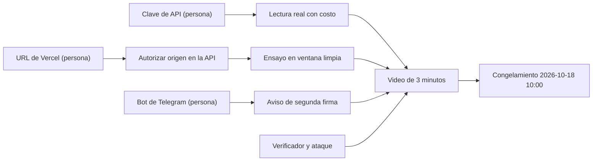

# Plan de ejecución de Kauta

Sirve para dejar claro qué se hizo (según git y el documento de estado) y qué falta hasta el congelamiento. Entrega: domingo 2026-10-18 12:00; se congela a las 10:00, y después no se agrega nada. Fecha: 2026-10-17.
Fuentes: `git log`, `hechos-del-codigo.md` §16, `docs/designs/kauta-estado-2026-10-17.md`, `docs/PRD.md` §11 y §14, `TODOS.md`. Horarios por tarea: NO DOCUMENTADO (el PRD no los fija).

## 1. Historia (git)

| Commit | Fecha | Qué entregó |
|---|---|---|
| `c5c9713` | 2026-10-16 | Brief del reto y responsabilidades (`README.md`) |
| `ce7ffa8` | 2026-10-17 | Cuatro prototipos HTML y biblioteca de facturas |
| `ffbc43a` | 2026-10-17 | Importa `kauta/` completa: 3 roles, entrada por persona, reevaluación (145 archivos) |
| `b1ee286` | 2026-10-17 | Libro de costos y métricas FinOps con una sola fuente |
| `7a9e108` | 2026-10-17 | Completa la demo FinOps y prepara Vercel (quita Login y Personas; agrega Rendimiento, recibo, `ops/`, `vercel.json`, recorrido web) |

## 2. Estado por bloque (plan de rediseño frente a hoy)

El documento de estado de la mañana marcaba T9 a T13 como pendientes; su continuación y el README las dan como hechas. Se toma la continuación y el commit `7a9e108` (ver hechos §16).

| Bloque | Estado | Evidencia |
|---|---|---|
| T1 importación | Código en git; auditoría de secretos y clon limpio no repetidos | `kauta-estado-2026-10-17.md:59` |
| T2 a T5 roles, persona, vencimiento R01, reevaluación | Hecho | `kauta-estado-2026-10-17.md:60-63` |
| T6 a T8 costos, métricas, semilla | Hecho, con pruebas | `kauta-estado-2026-10-17.md:64` |
| T9 y T10 front sin login, rediseño, Rendimiento y recibo | Hecho según la continuación | `kauta-estado-2026-10-17.md:5-12` |
| T11 orígenes | Existe `KAUTA_ORIGEN` y `KAUTA_ORIGENES_ADICIONALES`; falta el origen público definitivo | hechos §14 |
| T12 despliegue | API en `kauta.service` con HTTPS válido; Vercel pendiente | `kauta-estado-2026-10-17.md:14-19` |
| T13 recorrido web | Script Playwright hecho; ejecución para este documento NO VERIFICADA | `scripts/probar_web.mjs` |
| CI en GitHub Actions | Pendiente (TODO P2) | `TODOS.md` |

## 3. Qué falta hasta el congelamiento (PRD §14)

| Prioridad | Tarea | Depende de | Estado |
|---|---|---|---|
| 1 | Lectura real de una factura nueva con costo medido | Clave de `ANTHROPIC_API_KEY` (persona) | Pendiente; hoy la lectura del set es de referencia y no se registran tokens reales |
| 2 | Evidencia de seguridad independiente: verificador, ataque con variantes, lámina "lo que no probamos" | Permiso para tocar el repositorio (pregunta abierta, PRD §15) | Pendiente |
| 3 | URL pública en Vercel y ensayo desde ventana limpia | URL asignada para autorizar el origen en la API | Pendiente de persona |
| 4 | Aviso de Telegram por segunda firma pendiente | Bot con @BotFather (persona) | Pendiente; no existe en el código |
| 5 | Video de 3 minutos en una sola historia | Tareas 1 a 4 | Pendiente; guion en `demo-script.md` |
| 6 | Opcional: flujo animado y contador de dinero protegido | Tiempo sobrante | Opcional |

## 4. Camino crítico

## 5. Preguntas abiertas (PRD §15)
- Quién consigue la clave del modelo y cuándo.
- Cuál es la URL final de Vercel y quién la publica.
- Si se permite tocar este repositorio para el verificador y el ataque, y quién los revisa.
- Si se conserva el set de 20 o se agregan casos para la evaluación independiente.
